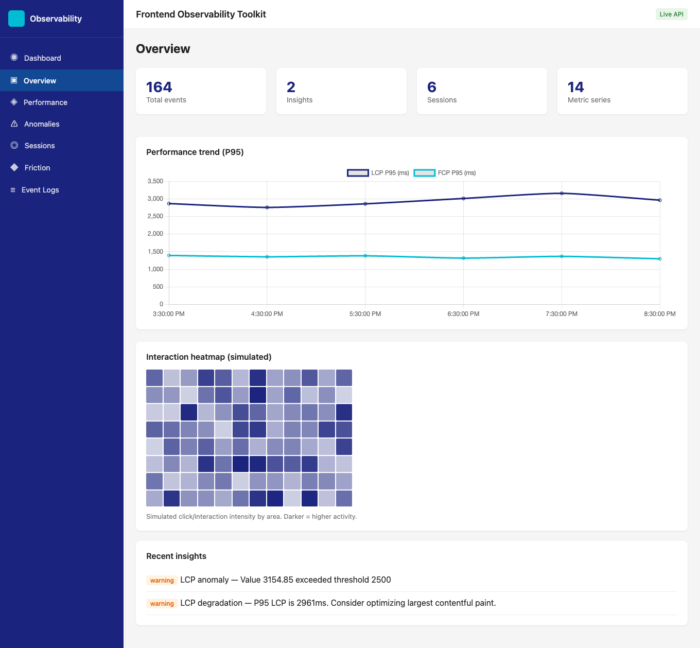

# Frontend Observability Toolkit

[](https://github.com/kashish14/Frontend-Observability-Toolkit/actions/workflows/ci.yml)

A small, end-to-end frontend observability stack written in TypeScript:

- **SDK** – tracks renders, user events, friction (rage/dead clicks, repeated navigation, long loading) and Web Vitals (FCP, LCP), then batches them to an ingest endpoint.
- **Analytics engine** – turns raw events into P50/P95 aggregates per hour, threshold and error-rate anomalies, insights and per-session summaries.
- **Mock backend** – an Express API that ingests events and serves the analytics output, seeded with sample data.
- **Dashboard** – an Angular 21 app with overview, performance, anomaly, session, friction and event-log views. The dashboard is itself instrumented with the SDK, so using it produces real data.



## How it fits together

```
Dashboard (Angular) ── SDK ──► POST /api/events ──► mock backend (in-memory store)
        ▲                                                   │
        │                                                   ▼
        └──── GET /api/metrics, /insights, ... ◄──── analytics-engine
```

The dashboard has two modes:

| Mode | Command | Data source |
|------|---------|-------------|
| Demo | `npm start` | In-app HTTP interceptor with fixed sample data. No backend needed. |
| Live | `npm run dev` | Mock backend + analytics engine. SDK events from your browsing show up after a page refresh. |

The header badge shows which mode is active ("Demo data" or "Live API").

## Getting started

Requires Node.js 20.19+ (CI runs on Node 22).

```bash
npm install     # also builds sdk/ and analytics-engine/ (postinstall)
npm run dev     # mock backend on :3000 + dashboard on :4200 (live mode)
```

Open http://localhost:4200. Click around: navigation, clicks and paint timings are sent by the SDK to `POST /api/events`, and the Sessions, Performance and Overview pages pick them up on the next load.

Dashboard only, with demo data:

```bash
npm install
npm start       # http://localhost:4200
```

The backend port can be changed with `PORT`, and the dashboard proxy target with `API_TARGET` (see `dashboard/proxy.conf.js`).

## Scripts

Run from the repository root.

| Script | What it does |
|--------|--------------|
| `npm run dev` | Build the backend, then run backend + dashboard (live mode) together. |
| `npm start` | Dashboard with in-app demo data. |
| `npm run start:live` | Dashboard in live mode only (expects the backend on :3000). |
| `npm run start:backend` | Mock backend only (run `npm run build:backend` first). |
| `npm run build` | Build every package in dependency order: sdk, analytics-engine, mock-backend, dashboard. |
| `npm test` | Run all test suites. |

## Using the SDK

```ts
import { ObservabilitySDK } from '@frontend-observability/sdk';

const sdk = ObservabilitySDK.init({
  endpoint: '/api/events',
  sampleRate: 1,
  batchSize: 10,
  flushIntervalMs: 5000,
});

sdk.setRoute('/checkout');
sdk.trackEvent('checkout_started', { metadata: { step: 1 } });
sdk.trackRender('CheckoutComponent', 'render', 15);
sdk.eventMonitor.trackClick('button#pay');
sdk.performanceTiming.captureFCP();
sdk.performanceTiming.captureLCP();

sdk.getMetrics$().subscribe((event) => console.log(event)); // every event, as an RxJS stream
sdk.destroy(); // flush the queue and stop the timer
```

Events are batched and sent with `fetch` (`keepalive`, so the last batch survives a page unload). Failed sends are re-queued. See `dashboard/src/app/core/services/observability-sdk.service.ts` for an Angular integration that hooks into the router.

## API

| Method | Path | Description |
|--------|------|-------------|
| `POST` | `/api/events` | Ingest `{ events: IngestEvent[] }`. Returns `202 { accepted }`. |
| `GET` | `/api/metrics` | Hourly P50/P95 aggregates per metric. |
| `GET` | `/api/anomalies` | Threshold and error-rate anomalies. |
| `GET` | `/api/insights` | Human-readable insights derived from aggregates and anomalies. |
| `GET` | `/api/sessions` | Per-session counts (events, friction, errors) and FCP/LCP. |
| `GET` | `/api/events/summary` | Total event count and count by type. |
| `GET` | `/health` | Liveness check. |

## Project structure

```
sdk/               Browser SDK (TypeScript, RxJS), unit tests with Jest
analytics-engine/  Aggregation, anomaly detection, insights, sessions; Jest tests
mock-backend/      Express ingest + query API (src/app.ts) and seed data
dashboard/         Angular 21 app (standalone components, lazy routes, Chart.js)
tests/             Integration (API contract + SDK end to end) and SDK overhead tests
docs/              Architecture, decision log, product vision, testing strategy
```

npm workspaces link the packages together; `sdk` and `analytics-engine` compile to `dist/`, which the dashboard and backend import.

## Testing

```bash
npm test
```

- `sdk`, `analytics-engine` – Jest unit tests.
- `dashboard` – Karma + Jasmine in headless Chrome (needs Chrome installed).
- `tests` – starts the mock backend in-process on a random port, checks the API contract, and verifies that events sent by the SDK show up in the summary, sessions and metrics endpoints. Also a timing check on SDK overhead.

More detail in [docs/testing-strategy.md](docs/testing-strategy.md). Design notes are in [docs/architecture.md](docs/architecture.md) and [docs/decision-log.md](docs/decision-log.md).

## Limitations

- The backend stores events in memory; restarting it resets to the seed data.
- The interaction heatmap on the Overview page is simulated.
- The SDK ships as CommonJS; an ESM build would let bundlers tree-shake it.

## License

[MIT](LICENSE)
